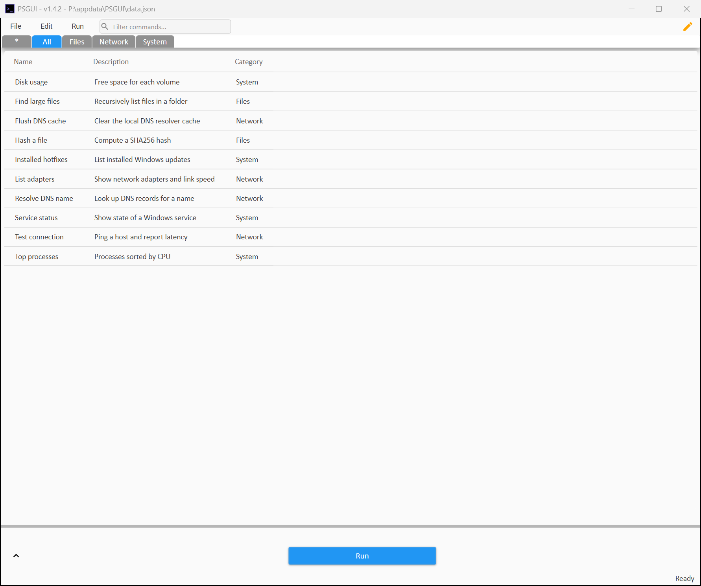

# PSGUI

[](https://github.com/stjiub/psgui/actions/workflows/ci.yml)
[](LICENSE)

A desktop launcher for your PowerShell commands. Keep the commands you run often in a searchable, categorized list, fill in their parameters in a form, and run them in an embedded shell tab or a separate window, with optional logging and a history you can re-run.

<p align="center">
  
</p>

## Features

- **Command library** in a plain JSON file, grouped into category tabs, with a filter box and a favorites tab you can reorder
- **Parameter form** generated from the command's own parameters: text boxes, switches as check boxes, and drop-downs for `ValidateSet`
- **Run attached** in a shell tab inside PSGUI, **run detached** in its own window, or **inject** a command into a shell that is already open
- **Per-command options**: pre/post commands, skip the parameter form, override the shell, and log to a transcript or to [PSTask](https://github.com/stjiub/pstask) logs (optionally with parameter values in the log file name)
- **Command history** with re-run, copy, and open-log, kept in sync between multiple PSGUI instances
- **Edit mode** with add, duplicate, remove and undo-delete; changes to the data file made by another instance are picked up automatically
- **Settings dialog** for shell, logging, history, PowerShell profile loading and sync intervals

## Requirements

- Windows 10 or 11
- Windows PowerShell 5.1 (the default shell and the host the compiled exe uses)
- Optional: the [PSTask](https://github.com/stjiub/pstask) module, for PSTask logging

## Install

Download the latest `PSGUI-<version>.zip` from the [Releases](https://github.com/stjiub/psgui/releases) page, extract it somewhere, and run `PSGUI.exe`. Keep `PSGUI.exe`, `icon.ico`, `defaultsettings.json` and the `Assembly` folder together.

The release exe is not code-signed, so Windows SmartScreen may warn on first run. You can verify the download against the `.sha256` file on the release, or build it yourself.

## Build from source

```powershell
git clone https://github.com/stjiub/psgui.git
cd psgui
./build.ps1 -Task Run      # assemble dist/ and launch it
./build.ps1 -Task Build    # also compile dist/PSGUI.exe with PS2EXE
```

`build.ps1` tasks:

| Task | What it does |
| --- | --- |
| `Combine` | Assemble `src/` into a single `dist/PSGUI.ps1` and copy `assets/` beside it |
| `Build` | `Combine`, then compile `dist/PSGUI.exe` with [PS2EXE](https://github.com/MScholtes/PS2EXE) (`-RequireAdmin` makes the exe ask for elevation) |
| `Analyze` | PSScriptAnalyzer over `src/` |
| `Test` | `Analyze`, then the Pester tests (`-Coverage` writes `coverage.xml`) |
| `Run` | `Combine`, then launch `dist/PSGUI.ps1` in Windows PowerShell |

## Using PSGUI

Your commands live in a data file, `%APPDATA%\PSGUI\data.json` by default. A new empty one is created on first run. Switch to edit mode (the pencil, or **Edit > Edit Mode**) to add rows, then fill in at least a name, category and command.

| Column | Meaning |
| --- | --- |
| Name, Description, Category | What you see in the list. Each category becomes a tab |
| Command | A function, cmdlet or script to run. Its parameters become the form |
| SkipParameterSelect | Run immediately without showing the form |
| PreCommand / PostCommand | Run before or after the command, in the same session |
| Transcript / PSTask | Log the run with `Start-Transcript` or PSTask logging |
| PSTaskMode / PSTaskVisibilityLevel | Passed to `Set-PSTaskMode` and `Set-PSTaskVisibilityLevel` |
| ShellOverride | Use a different shell than the default, for example `pwsh` |
| LogParameterNames | Comma-separated parameter names whose values are added to the log file name |

Select a row and press **Run** (or Enter). **Ctrl+S** saves.

### Data file format

```json
{
  "CommandListId": "6f1f0f0e-8a0e-4b0e-9d2b-0c7f3c1e2a11",
  "Commands": [
    {
      "Id": "0b7c8e6a-3d5a-4a55-8d57-9f1b0c6f2d10",
      "Name": "Test connection",
      "Description": "Ping a host and report latency",
      "Category": "Network",
      "Command": "Test-NetConnection",
      "SkipParameterSelect": false,
      "PreCommand": "",
      "PostCommand": "",
      "Transcript": false,
      "PSTask": false,
      "PSTaskMode": "",
      "PSTaskVisibilityLevel": "",
      "ShellOverride": "",
      "LogParameterNames": ""
    }
  ]
}
```

`CommandListId` ties favorites to a particular data file, so favorites stay correct when you switch between files. Older files (a bare array of commands, integer ids, or the previous single `Log` field) are migrated when loaded.

### Settings

Settings are stored in `%APPDATA%\PSGUI\settings.json`; defaults are in [`assets/defaultsettings.json`](assets/defaultsettings.json) and every value can be changed from **File > Settings**.

| Setting | Default | Purpose |
| --- | --- | --- |
| `DefaultShell` / `DefaultShellArgs` | `powershell` | Shell for the embedded Shell tab |
| `DefaultRunCommandAttached` | `true` | Run in the embedded shell by default |
| `OpenShellAtStart` | `false` | Show the shell panel on launch |
| `DefaultLogsPath` | `%APPDATA%\PSGUI\logs` | Where transcripts and PSTask logs go |
| `DefaultDataFile` | `%APPDATA%\PSGUI\data.json` | Command library to open at start |
| `CommandHistoryLimit` / `SaveHistory` | `50` / `true` | History size and persistence |
| `HistorySyncIntervalSeconds` / `DataFileSyncIntervalSeconds` | `30` | How often multiple instances sync |
| `UseProfile` / `ProfilePath` | `false` | Dot-source a PowerShell profile before each command |
| `EnablePSTask` | `false` | Offer PSTask logging options |
| `ShowDebugTab` | `false` | Show the internal debug log tab |
| `StatusTimeout` | `6` | Seconds the status bar message stays up |

## Security notes

PSGUI exists to run PowerShell, so treat its data file like a script:

- **Only open data files you trust.** A command, pre-command or post-command in a data file runs with your privileges, and with elevation if you built the exe with `-RequireAdmin`.
- **Parameter values are inserted into the command line inside double quotes**, so PowerShell expands `$variables` and `$( )` in them when the command runs. This lets you use `$env:COMPUTERNAME` in a field, but means a value copied from an untrusted source can execute code.
- Commands are launched with `-ExecutionPolicy Bypass` so that unsigned scripts you point it at can run.
- Settings, history, favorites and logs are stored unencrypted under `%APPDATA%\PSGUI`. History records the parameters you ran commands with, so avoid putting secrets in parameters.

## Project layout

```
src/Functions/   application code, one file per area (combined in file-name order)
src/Main.ps1     app version, paths, assembly loading, entry point
src/*.xaml       window definitions (embedded in the combined script)
src/Win32API.cs  small P/Invoke helper (embedded)
assets/          files that ship next to the exe: icon, default settings, UI assemblies
tests/           Pester 5 tests
build.ps1        combine, build, analyze and test
```

## Development

```powershell
Install-Module Pester -MinimumVersion 5.5 -Scope CurrentUser
Install-Module PSScriptAnalyzer -Scope CurrentUser
./build.ps1 -Task Test -Coverage
```

The tests cover data and settings persistence, favorites, command parsing, history summaries, argument building, and static checks (syntax, XAML, settings and UI-name wiring, repository hygiene). Most of the code is WPF event handling that needs a live window, so overall line coverage is low; logic worth testing is extracted into functions that can be called without the UI. See [CONTRIBUTING.md](CONTRIBUTING.md).

## License

[MIT](LICENSE). Bundled third-party components are listed in [THIRD-PARTY.md](THIRD-PARTY.md).
